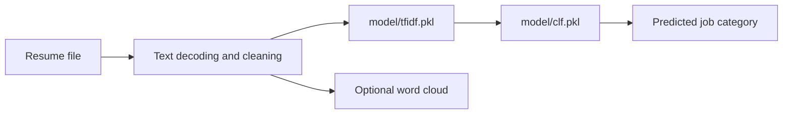

# Resume Screening App

**Explore resume-category classification with a small Streamlit application.**

The app shows how text cleaning, TF-IDF features, and a saved classifier can turn a resume into a predicted job category. It is a learning project for NLP application development and a starting point for reviewing classification behavior.

## What it does

- Accepts an uploaded file and decodes its contents as text.
- Removes URLs, mentions, punctuation, and selected non-ASCII characters.
- Applies a saved TF-IDF vectorizer and classifier.
- Maps prediction IDs to 25 job-category labels.
- Provides an optional word-cloud view of the cleaned text.

## Architecture



## Run locally

Download and extract the repository, then open a terminal in its root directory.

```bash
python -m pip install -r requirements.txt
python -m pip install scikit-learn
python -m streamlit run app.py
```

The dependency file contains older pinned packages; choose a compatible Python environment. The saved classifier and vectorizer also require a compatible scikit-learn version, which is not pinned in the repository. NLTK downloads `punkt` and `stopwords` when the app starts.

## Example

Upload a UTF-8 `.txt` resume describing your own sample experience. The app displays a category such as **Python Developer** or **Data Science**, depending on the trained classifier. A category prediction is not a candidate score or a measure of suitability for a particular job.

## Repository guide

| Path | Purpose |
|---|---|
| [app.py](app.py) | Streamlit UI, cleaning, inference, and label mapping |
| [Untitled.ipynb](Untitled.ipynb) | Model-development notebook |
| `model/` | Serialized classifier and TF-IDF vectorizer |
| `dataset/UpdatedResumeDataSet.csv` | Included resume dataset |
| [requirements.txt](requirements.txt) | App dependency pins |

## Current limitations

The uploader accepts `.pdf`, but the code decodes file bytes rather than extracting PDF text. Use `.txt` for the implemented text flow. The optional word-cloud path calls `calculate_accuracy()`, which is not defined in `app.py`; that branch needs repair before use. There is no `train_model.py` in this repository.

Inspect classification errors and dataset coverage before adapting the project for a hiring workflow. Load pickle artifacts only from trusted sources.

## Contributing

Useful contributions include a real PDF extraction path, a reproducible training environment, and a working evaluation view. Include a small non-sensitive example that reproduces the behavior being changed.
